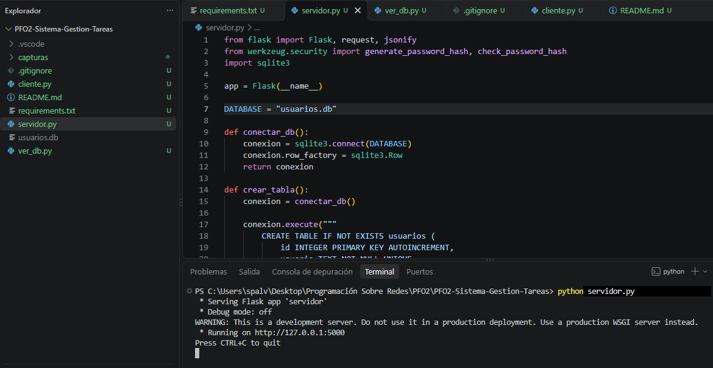
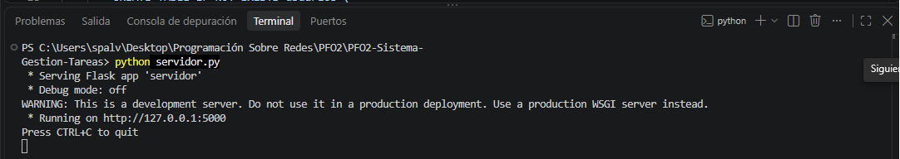
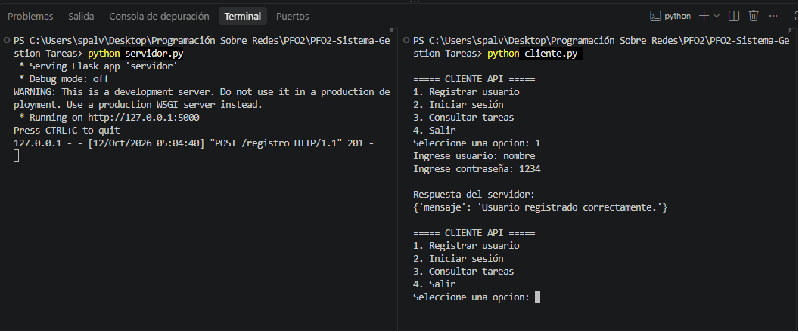
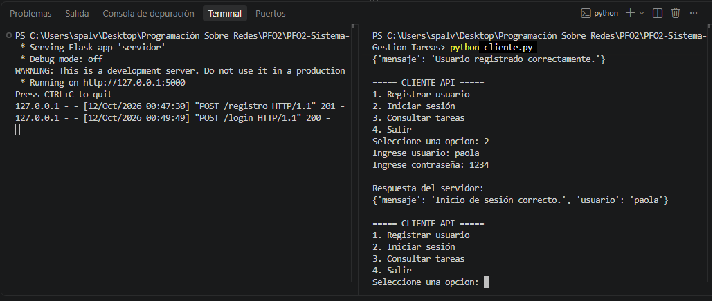
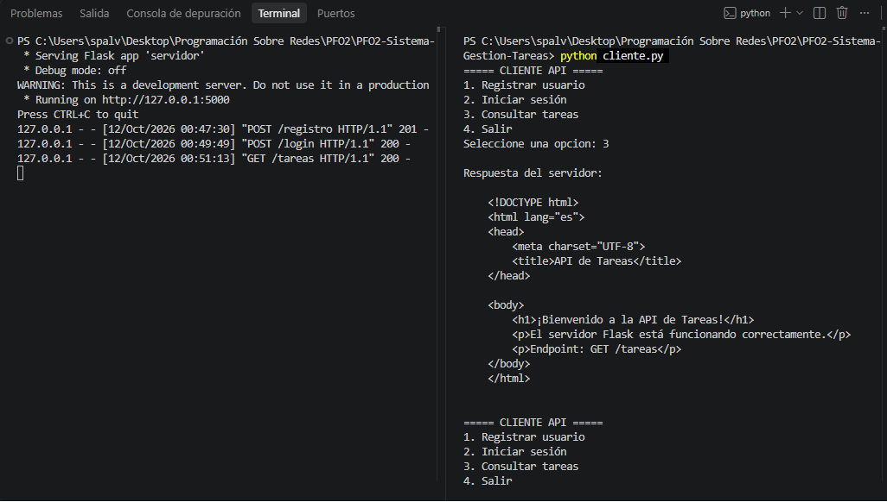
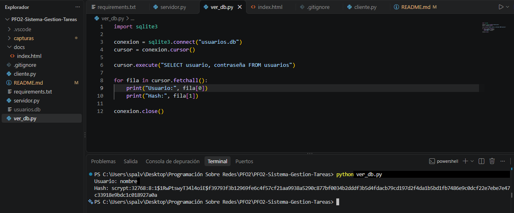
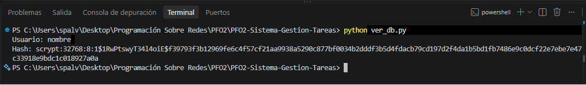

# Sistema de Gestión de Tareas con API y Base de Datos

## 1. Descripción del proyecto

Este proyecto consiste en el desarrollo de una API con Flask y SQLite que permite registrar usuarios, validar sus credenciales y comprobar el funcionamiento del servidor mediante un endpoint de prueba.

El sistema almacena los usuarios en una base de datos SQLite y utiliza hashes para proteger las contraseñas almacenadas.

La aplicación cuenta con un servidor (`servidor.py`) y un cliente por consola (`cliente.py`) que permite interactuar con la API mediante un menú de opciones.

## 2. Tecnologías utilizadas

- **Python:** lenguaje de programación.
- **Flask:** framework para desarrollar la API.
- **SQLite:** base de datos para almacenar los usuarios.
- **Werkzeug:** biblioteca utilizada para generar y verificar los hashes de las contraseñas.
- **Requests:** biblioteca utilizada por el cliente para enviar solicitudes HTTP al servidor.

## 3. Funcionalidades

- Registro de usuarios.
- Validación de los campos obligatorios.
- Detección de usuarios duplicados.
- Inicio de sesión mediante la verificación de credenciales.
- Almacenamiento de contraseñas mediante hashes.
- Consulta del endpoint de prueba `/tareas`.
- Respuestas HTTP que permiten identificar el resultado de las solicitudes.

## 4. Endpoints de la API

### 4.1. Registro de usuarios

**Método:** `POST`

**Endpoint:** `/registro`

Permite registrar un usuario en la base de datos.

**Ejemplo de solicitud JSON:**

```json
{
  "usuario": "nombre",
  "contraseña": "1234"
}
```

**Respuestas principales:**

- `201 Created`: usuario registrado correctamente.
- `400 Bad Request`: faltan datos obligatorios o la solicitud no contiene datos JSON válidos.
- `409 Conflict`: el usuario ya existe.

### 4.2. Inicio de sesión

**Método:** `POST`

**Endpoint:** `/login`

Permite verificar las credenciales de un usuario registrado.

**Ejemplo de solicitud JSON:**

```json
{
  "usuario": "nombre",
  "contraseña": "1234"
}
```

**Respuestas principales:**

- `200 OK`: inicio de sesión correcto.
- `400 Bad Request`: faltan datos obligatorios o la solicitud no contiene datos JSON válidos.
- `401 Unauthorized`: usuario o contraseña incorrectos.

### 4.3. Consulta de tareas

**Método:** `GET`

**Endpoint:** `/tareas`

Devuelve una página HTML de bienvenida que permite comprobar que el servidor Flask está funcionando correctamente.

**URL local:** `http://127.0.0.1:5000/tareas`

Este endpoint es una respuesta de prueba. No implementa operaciones de creación, consulta, modificación o eliminación de tareas almacenadas en una base de datos.

## 5. Cliente de la API

El archivo `cliente.py` permite interactuar con el servidor mediante un menú por consola.

Las opciones disponibles son:

1. **Registrar usuario:** solicita un nombre de usuario y una contraseña, y envía los datos al endpoint `POST /registro`.
2. **Iniciar sesión:** solicita las credenciales y las envía al endpoint `POST /login` para validar el acceso.
3. **Consultar tareas:** realiza una solicitud `GET /tareas` y muestra la respuesta HTML recibida del servidor.
4. **Salir:** finaliza la ejecución del cliente.

El cliente utiliza la biblioteca `Requests` para comunicarse con el servidor local mediante la dirección `http://127.0.0.1:5000`.

## 6. Base de datos y seguridad

La base de datos `usuarios.db` se crea automáticamente al iniciar el servidor, si todavía no existe.

Contiene la tabla `usuarios`, con los siguientes campos:

| Campo | Descripción |
|---|---|
| `id` | Identificador único del usuario. |
| `usuario` | Nombre de usuario, obligatorio y único. |
| `contraseña` | Hash de la contraseña almacenada. |

Para proteger las contraseñas se utilizan las funciones `generate_password_hash()` y `check_password_hash()` de Werkzeug.

Las contraseñas no se almacenan directamente en texto plano. Al iniciar sesión, el sistema verifica la contraseña ingresada utilizando el hash guardado en la base de datos.

Además, las consultas SQL utilizan parámetros para evitar incorporar directamente los datos ingresados por el usuario en las sentencias SQL.

## 7. Instalación y ejecución

### 7.1. Requisitos previos

- Python instalado.
- Git instalado para clonar el repositorio.
- Las dependencias especificadas en `requirements.txt`.

### 7.2. Clonar el repositorio

Clonar el repositorio de GitHub desde la terminal:

```bash
git clone https://github.com/pao-1112/PFO2-Sistema-Gestion-Tareas.git
```

Ingresar a la carpeta del proyecto:

```bash
cd PFO2-Sistema-Gestion-Tareas
```

También es posible descargar el repositorio como archivo ZIP desde GitHub y descomprimirlo en la computadora.


### 7.3. Instalar las dependencias

Ejecutar el siguiente comando desde la carpeta del proyecto:

```bash
pip install -r requirements.txt
```

Si el comando pip no funciona, se puede intentar con:

```bash
python -m pip install -r requirements.txt
```

### 7.4. Ejecutar el servidor

En una terminal, ejecutar:

```bash
python servidor.py
```

El servidor se iniciará en la dirección local `http://127.0.0.1:5000`.

### 7.5. Ejecutar el cliente

Abrir una segunda terminal, ubicarse en la carpeta del proyecto y ejecutar:

```bash
python cliente.py
```
### 7.6. Probar el sistema

Desde el menú del cliente se pueden probar las operaciones disponibles:

- Registrar un usuario utilizando las credenciales indicadas por la consigna: usuario "nombre" y contraseña "1234".
- Iniciar sesión con esas credenciales.
- Consultar el endpoint de tareas.
- Verificar que las operaciones devuelvan las respuestas esperadas.

**Importante:** si el usuario ya fue registrado en la base de datos, no es necesario registrarlo nuevamente para probar el inicio de sesión. Simplemente seleccioná la opción correspondiente e ingresá las credenciales utilizadas durante el registro.

Si intentás registrar otra vez el mismo usuario, el sistema mostrará un mensaje indicando que ya existe.

Si deseás comenzar las pruebas con una base de datos vacía, detené la ejecución del servidor y eliminá el archivo `usuarios.db`. Al iniciar nuevamente `servidor.py`, se creará una nueva base de datos vacía y podrás registrar usuarios desde cero.

**Precaución**: eliminar `usuarios.db` borra todos los usuarios almacenados en esa base de datos.

**Aclaración:** el servidor debe permanecer en ejecución mientras se utiliza el cliente. Si se intenta registrar un usuario que ya existe, se deberá utilizar otro nombre de usuario o iniciar sesión con las credenciales correspondientes.

## 8. Pruebas realizadas

Se realizaron pruebas para verificar el funcionamiento de los componentes principales del proyecto:

- Inicio del servidor Flask. 
- Registro exitoso de un usuario.
- Manejo del intento de registrar un usuario existente.
- Inicio de sesión con credenciales correctas.
- Rechazo de credenciales incorrectas.
- Respuesta del endpoint `GET /tareas`.
- Verificación del almacenamiento de la contraseña mediante un hash en SQLite.

### 9. Evidencias de ejecución

- Las evidencias corresponden a las siguientes pruebas:
- Inicio del servidor Flask (servidor.png y servidor1.png).



- Registro exitoso de un usuario (registro.png).


- Inicio de sesión correcto (login.png).


- Consulta de la página HTML de bienvenida (tareas.png).


- Verificación del hash almacenado en SQLite (hash_sqlite.png y hash_sqlite1.png).




Las capturas de pantalla correspondientes se encuentran en la carpeta `capturas/` del repositorio.

## 10. Solución de problemas

- **Python no se reconoce como comando:** verificar que esté instalado y disponible en el PATH. En Windows también se puede probar `py servidor.py`.
- **Faltan módulos:** ejecutar `python -m pip install -r requirements.txt`.
- **El puerto 5000 está ocupado:** detener el proceso que lo utiliza antes de iniciar el servidor.
- **El cliente no se conecta:** comprobar que el servidor esté activo y que el cliente utilice la dirección y el puerto correctos.
- **No se encuentra el usuario:** verificar que se esté utilizando la misma base de datos `usuarios.db` y que las credenciales sean correctas.

## 11. Preguntas Conceptuales

### ¿Por qué hashear contraseñas?

Hashear contraseñas permite almacenarlas de forma más segura, sin guardar el texto original en la base de datos. Si alguien accede a la base de datos, no encontrará directamente las contraseñas de los usuarios.
En este proyecto se utiliza `generate_password_hash()` de Werkzeug para generar el hash y `check_password_hash()` para verificar las credenciales durante el inicio de sesión.

### ¿Cuáles son las ventajas de usar SQLite en este proyecto?
SQLite permite almacenar los datos de manera persistente en un archivo local, sin necesidad de instalar ni administrar un servidor de base de datos independiente.
Sus principales ventajas en este proyecto son:
Simplicidad: es fácil de configurar y utilizar desde Python.
Persistencia: los usuarios registrados permanecen almacenados después de cerrar la aplicación.
Portabilidad: la base de datos se conserva en un archivo que puede trasladarse junto con el proyecto.
Integración: Python incluye el módulo `sqlite3`, por lo que no es necesario instalar una biblioteca adicional para conectarse a SQLite.

## 12. Enlaces del proyecto

- **Repositorio de GitHub:** https://github.com/pao-1112/PFO2-Sistema-Gestion-Tareas
- **GitHub Pages:** https://pao-1112.github.io/PFO2-Sistema-Gestion-Tareas/
